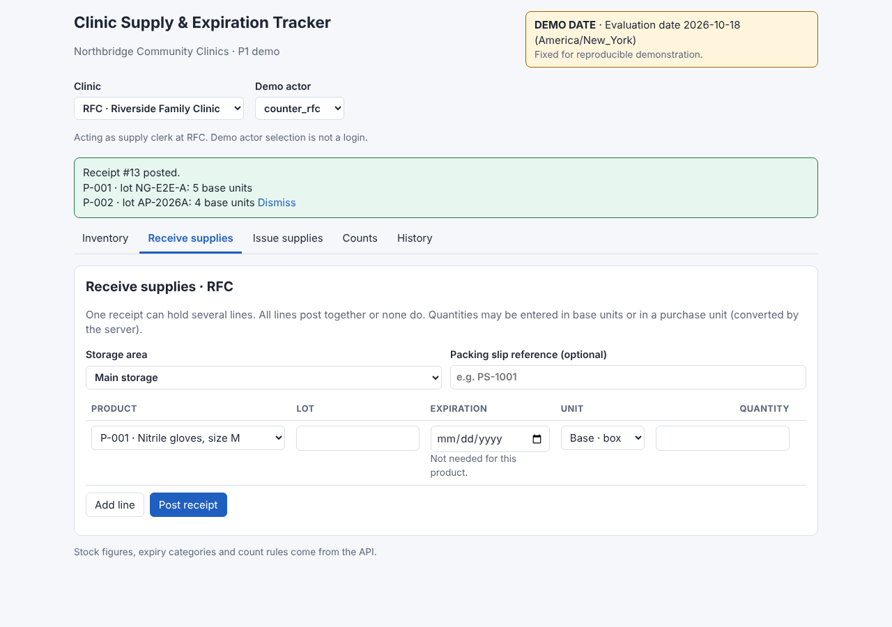
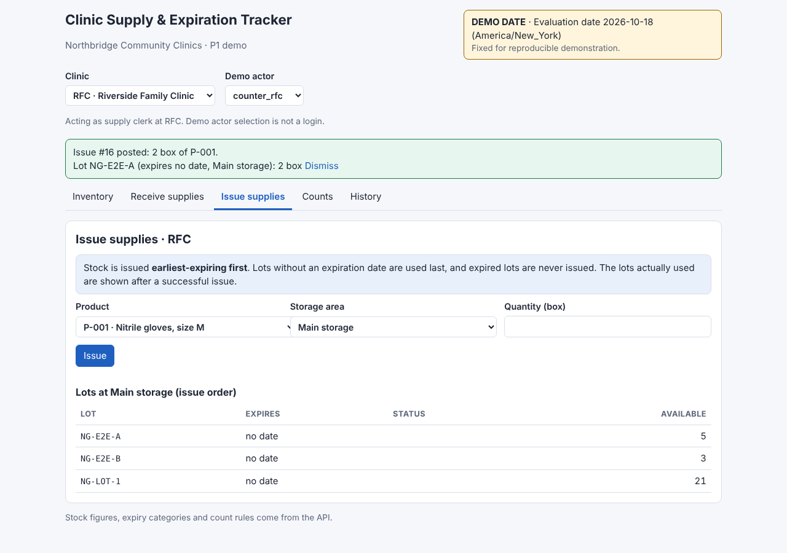
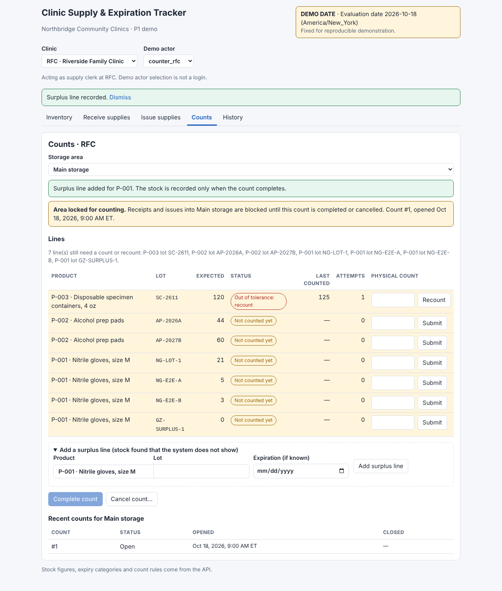
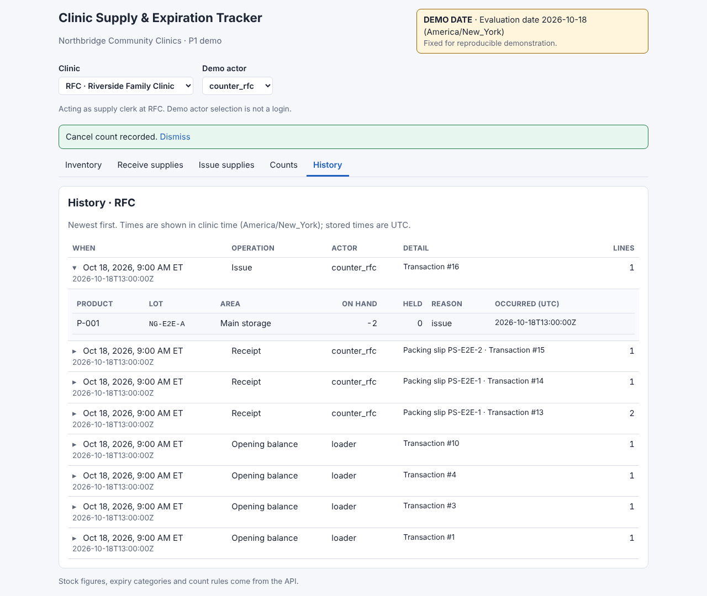
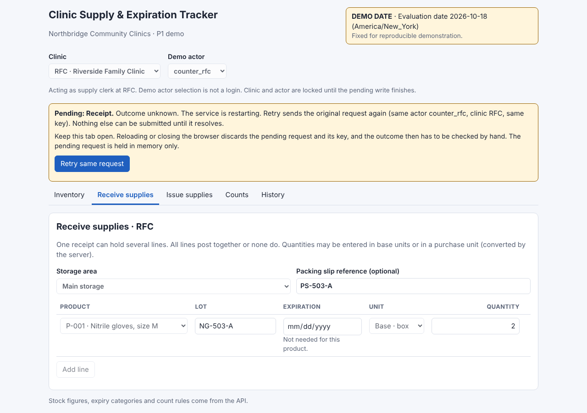

[README.md](https://github.com/user-attachments/files/34560576/README.md)
<div align="center">

# Clinic Supply & Expiration Tracker

### Multi-clinic supply control with lot tracking, counts, and retry-safe receiving

Clinic Supply & Expiration Tracker is a fictional demonstration for Northbridge Community Clinics. It tracks medical supplies across four clinics and two storage areas per clinic, records every stock movement, and makes sure a repeated or retried action never posts twice. Its P1 scope covers receiving, issuing, counts, and history.

**[Download the two-page brochure (PDF)](https://github.com/VicScottNYC/clinic-supply-tracker-demo/raw/main/docs/Clinic-Supply-Tracker-Brochure.pdf)** · **[Watch the walkthrough video (2–3 min)](https://github.com/VicScottNYC/clinic-supply-tracker-demo/blob/main/docs/video/walkthrough.mp4)**




<sub>Receiving: a posted receipt. Stock is added to the chosen clinic and storage area, with the lot and expiration recorded.</sub>

</div>

---

## Screenshots

<table>
<tr>
<td width="50%"></td>
<td width="50%"></td>
</tr>
<tr>
<td><b>Issuing</b>: a posted issue drawn from the earliest-expiring lot.</td>
<td><b>Counts</b>: a count with a discrepancy flagged beyond the set tolerance.</td>
</tr>
<tr>
<td></td>
<td valign="top"><br/><br/><b>History</b>: every movement with its actor, reason, and time. <b>Retry safety</b>: a pending write after a dropped request, with Retry.</td>
</tr>
</table>

## Features

- **Inventory:** stock by clinic and storage area, with expiration status for each lot.
- **Receiving:** multi-line receipts. A purchase unit, such as a case, converts to base units on the server. The demo assumes 1 case = 12 boxes, labelled as a demo assumption.
- **Issuing:** issues against a chosen lot, so the earliest-expiring supply goes first.
- **Counts:** a count holds one storage area, records each line, flags differences beyond a tolerance, and completes or cancels.
- **History:** every movement, with its actor, reason, and time.
- **Retry safety:** each write carries a submission key. The same key with the same request returns the saved result. A pending write stays in the tab until its outcome is known.

Not in P1: transfers, holds, approvals, and user administration. These are planned for P2.

## Technology stack

| Layer | Current implementation |
| --- | --- |
| Frontend | React 19, TypeScript, Vite 8, CSS |
| Frontend tooling | ESLint, npm with a committed package lockfile |
| API | Python, FastAPI, Pydantic (strict request validation), Uvicorn |
| Database | SQLite in WAL mode, foreign keys on, busy timeout |
| Testing | 86 backend tests, Playwright browser checks, axe-core accessibility audit |

## Architecture

```text
React + TypeScript (Vite)
└── REST / JSON
    └── FastAPI
        ├── Pydantic request validation
        ├── Explicit BEGIN IMMEDIATE transaction for every write
        ├── Submission-key table for idempotent writes
        └── SQLite (WAL) with an append-only movement table
```

Stock is recorded in an append-only movement table, with triggers that block updates and deletes. Balances are a cache. A single injectable clock produces UTC audit times and the America/New_York business date, so tests can run on a fixed date.

```text
frontend/ React application, components and the pending-write store
demo_data/p1db/ Loader, schema and demo database scripts
docs/ Brochure, screenshots, walkthrough video and design notes
```

## Local setup

### Prerequisites

- Python 3 with a virtual environment, using the packages in `requirements-api.txt`
- Node.js with npm

### 1. Build the demo database

```sh
cd demo_data/p1db
../../.venv/bin/python loader_p1.py ~/clinic-demo/northbridge-demo.db
```

The loader refuses to overwrite an existing database.

### 2. Start the API

```sh
P1_DB_PATH=~/clinic-demo/northbridge-demo.db P1_CLOCK=fixed ../../.venv/bin/uvicorn api_p1:make_app --factory --host 127.0.0.1 --port 8000
```

The API refuses to start if its database file doesn't exist.

### 3. Start the frontend

```sh
cd frontend
npm ci
npm run dev
```

Open `http://localhost:5173/` in your browser.

### Development checks

```sh
cd frontend
npm run build
npm run lint
```

## Accessibility evidence and limits

- Automated audit with axe-core covers five states: desktop light and dark, phone light and dark, and a 640 CSS px reflow check. The 640 px case is a reflow check, not browser zoom.
- Keyboard-only checks cover the main screens and the pending-write recovery.
- Screen-reader checks were done manually with VoiceOver in Chrome and Safari. Results are recorded step by step in `frontend/ACCESSIBILITY.md`.
- Real 200% browser zoom was checked manually in Safari. A physical phone check was also done by hand.
- Automated checks cannot test focus order or screen-reader announcements. Those were tested manually.

## Security notes

- The "Demo actor" selector sets a header for demonstration. It is not authentication and should not be used with real data.
- Keep any future credentials and tokens out of source control, screenshots, and logs.

## Known limitations

- Pending writes are held in browser memory. Reloading or closing the tab discards them, and the outcome must be checked by hand. A banner warns about this.
- `X-Actor-Id` is a demo convenience, not authentication. Hosting waits until real sign-in and access controls exist (planned for P2).
- The demo uses a fixed date (2026-10-18) for reproducible results.
- The 1 case = 12 boxes conversion is a demo assumption.
- Concurrency is tested at the database and API level only. The app has not been load-tested with many simultaneous users.

## Development status and roadmap

P1 is complete. P2 is planned and not yet started.

| Phase | Status | Scope |
| --- | --- | --- |
| P1 — Receiving, issuing, counts, history | Completed | Stock by lot and area, retry-safe writes, accessibility checks |
| P2 — Sign-in and permissions | Planned | Authentication and location-based permissions |
| P2 — Holds and approvals | Planned | Holds and approvals above a set threshold |
| P2 — Transfers | Planned | Transfers between storage areas |
| Hosting | Planned | Hosted version after sign-in is in place |

<details>
<summary><b>Sprint notes</b></summary>

#### P1 — Receiving, issuing, counts, history

Built the SQLite core with append-only movements, the FastAPI write paths with submission keys, the React interface with the pending-write store, the accessibility audit, and the walkthrough. The README and brochure describe the delivered behaviour only.

#### P2 — Planned

Sign-in and permissions come first, then holds and approvals, then transfers. Hosting follows once sign-in is in place. Scope and acceptance criteria are not yet final.

</details>

---

<div align="center">

Built by **Victor Scott** · [github.com/VicScottNYC](https://github.com/VicScottNYC)

</div>
