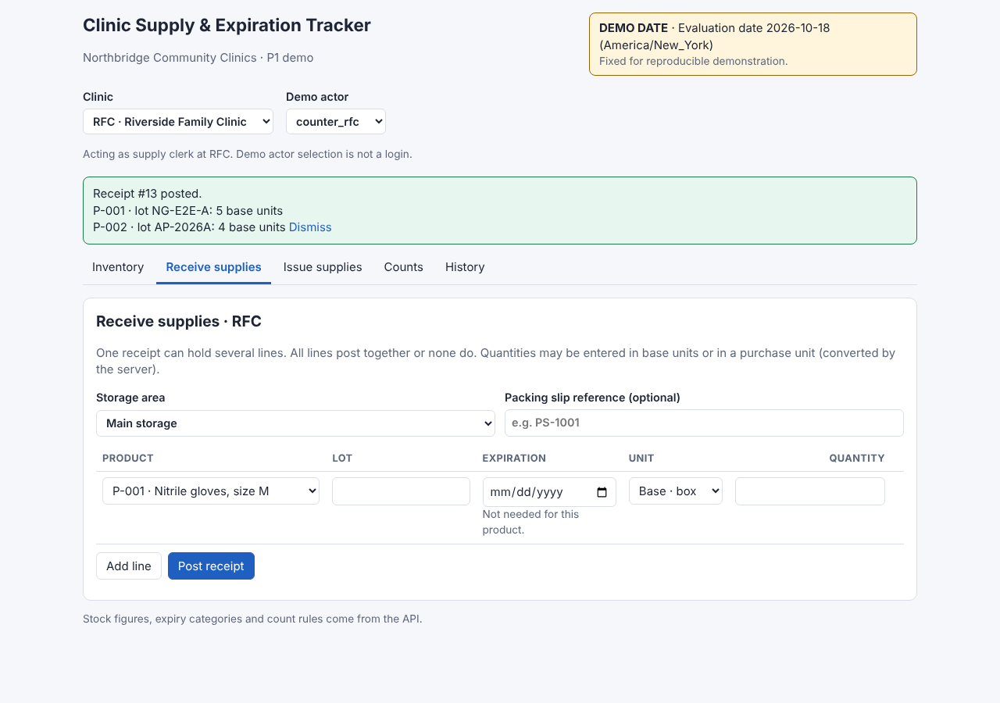
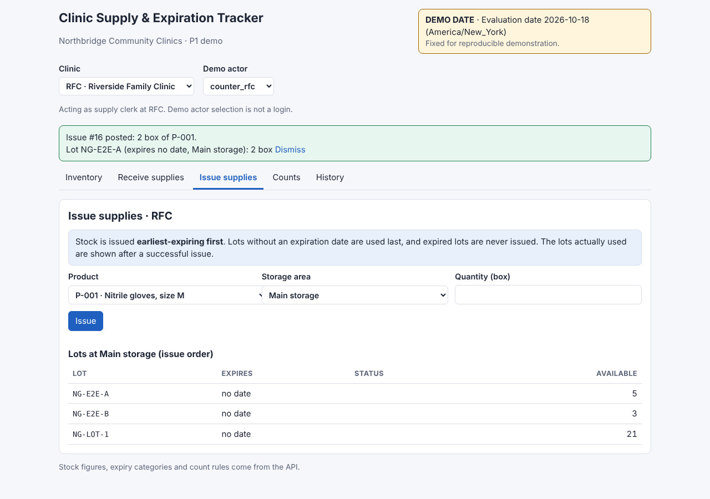
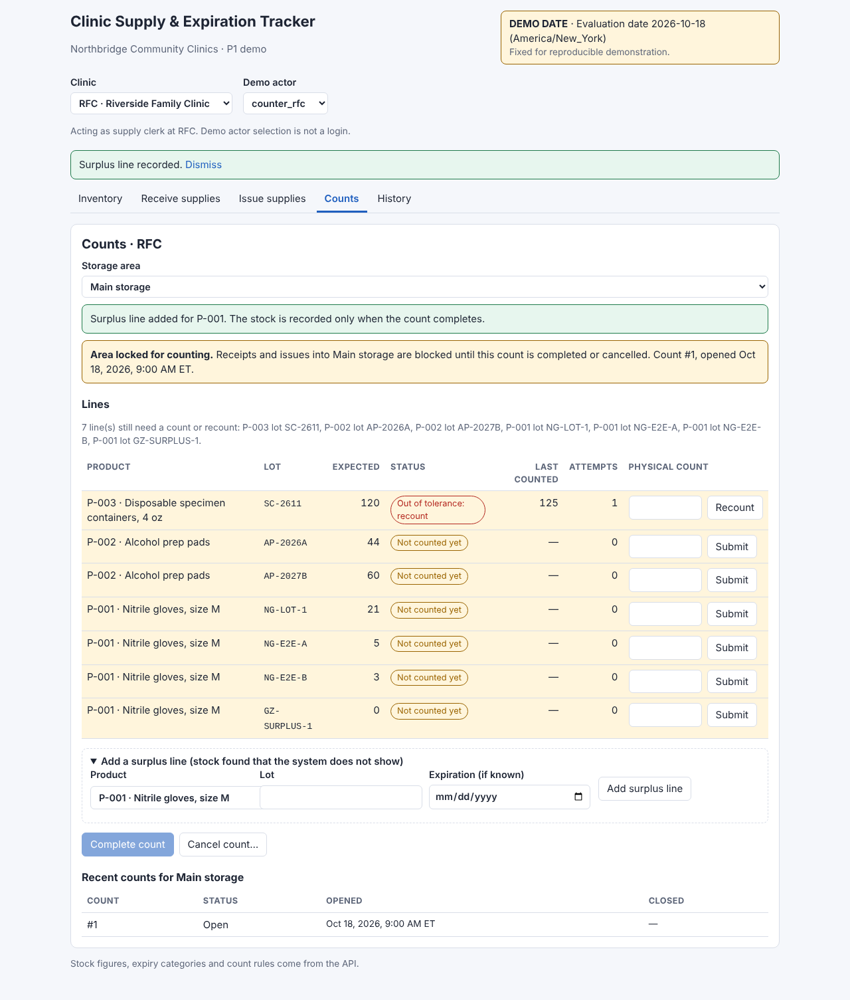
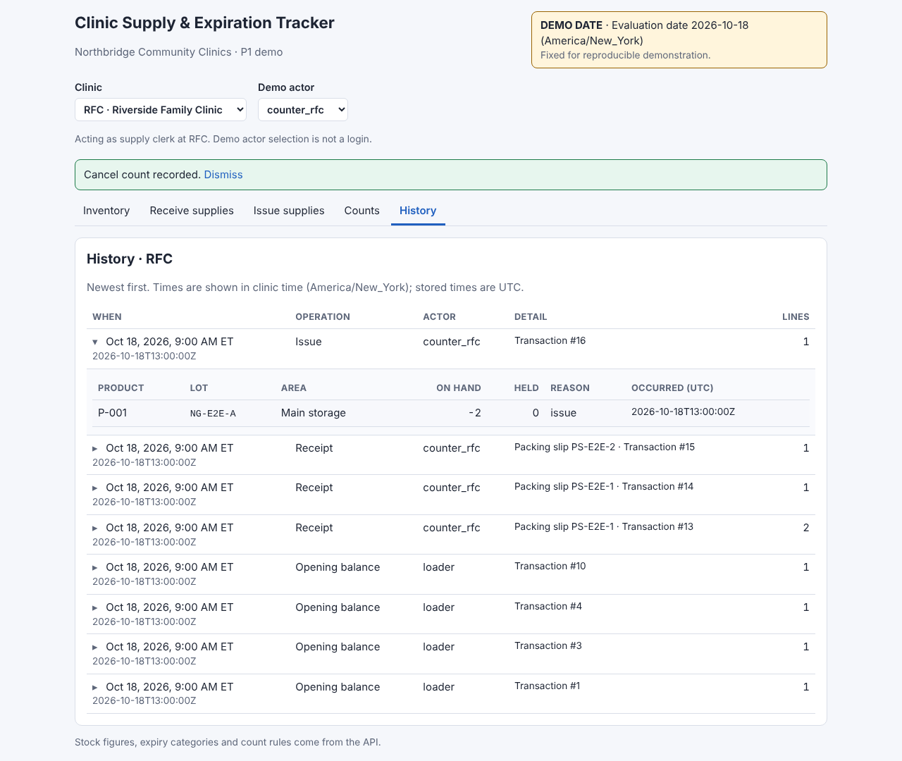
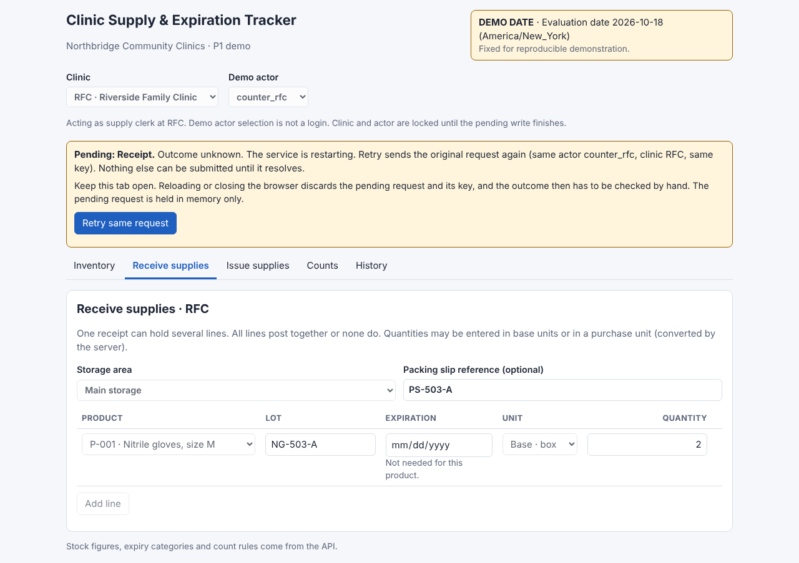

# Clinic Supply & Expiration Tracker (P1 demo)

A fictional demonstration for Northbridge Community Clinics. It tracks medical supplies across four clinics and two storage areas per clinic, records every stock movement, and makes sure a repeated or retried action never posts twice.

The data is fictional. The "Demo actor" selector is not a login.

## The operational problem

Small clinics often track supplies on paper or in spreadsheets. Three things go wrong:

- **Expiring stock is used last.** Without lot and expiration tracking, the oldest supplies sit on a shelf until they expire, and new stock gets used first.
- **Counts don't match records.** A physical count that differs from the recorded quantity is often corrected silently, so nobody can see why stock changed.
- **Retries create duplicates.** When a network connection drops during a receipt, staff often submit it again, and the stock is counted twice.

This project addresses all three for the P1 scope: receiving, issuing, counting, and history.

## Screenshots











## Walkthrough video

[Watch the two to three minute walkthrough](docs/video/walkthrough.mp4)

The video covers: receiving 2 cases (24 boxes), issuing the earliest-expiring lot, resolving a count discrepancy, and inspecting history.

## What it does (P1)

- **Inventory:** stock by clinic and storage area, with expiration status.
- **Receive:** multi-line receipts. A purchase unit (such as a case) converts to base units on the server. The demo assumes 1 case = 12 boxes, labelled as a demo assumption, not a supplier specification.
- **Issue:** issues against a chosen lot.
- **Counts:** a count holds the storage area, records each line, flags discrepancies beyond a tolerance, and completes or cancels.
- **History:** every movement, with its actor, reason, and time.
- **Retry safety:** each write has a submission key. The same key with the same request returns the saved result. A pending write is kept in the tab until its outcome is known.

Not in P1: transfers, holds, approvals, and user administration.

## Architecture

- **Database:** SQLite in WAL mode, with foreign keys on and a busy timeout. Stock is recorded in an append-only movement table, with triggers that block updates and deletes. Balances are a cache.
- **API:** FastAPI with strict request validation (pydantic). All writes run in an explicit `BEGIN IMMEDIATE` transaction. Every write is idempotent through a submission-key table.
- **Clock:** one injectable clock source produces both UTC audit times and the America/New_York business date.
- **Frontend:** React 19 with TypeScript, built with Vite. The pending-write store sits above the screens, so changing tabs does not drop a pending request.

## Setup

Backend (Python environment with the packages in `requirements-api.txt`):

```
cd demo_data/p1db
../../.venv/bin/python loader_p1.py ~/clinic-demo/northbridge-demo.db
P1_DB_PATH=~/clinic-demo/northbridge-demo.db P1_CLOCK=fixed ../../.venv/bin/uvicorn api_p1:make_app --factory --host 127.0.0.1 --port 8000
```

Frontend (Node.js, with a committed lockfile):

```
cd frontend
npm ci
npm run dev
```

Open the address Vite prints, usually http://localhost:5173/.

The loader refuses to overwrite an existing database. The API refuses to start if its database file doesn't exist.

## Tests

- **Backend:** 86 automated tests across the database rules and the API (57 database, 29 API).
- **Frontend:** type checking, build, and browser checks for the walkthrough, recovery cases, keyboard use, and an automated accessibility audit.
- **Accessibility:** automated audit with axe-core, covering five states (desktop light and dark, phone light and dark, and a 640 px reflow). Keyboard-only checks cover the main screens and the pending-write recovery.

## Accessibility evidence and limits

Recorded in [frontend/ACCESSIBILITY.md](frontend/ACCESSIBILITY.md).

- Automated checks cannot test focus order or screen-reader announcements. These were tested manually with VoiceOver in Chrome and Safari, and results are recorded step by step.
- The 640 px automated case is a reflow check, not browser zoom. Real 200% zoom was checked manually in Safari.
- A physical phone check was done by the author; its results are recorded in the accessibility document.

## Known limitations

- Pending writes are held in browser memory. Reloading or closing the tab discards them, and the outcome must be checked by hand. A banner warns about this.
- `X-Actor-Id` is a demo convenience, not authentication. Hosting is deferred until real sign-in and access controls exist (planned for the next phase).
- The demo uses a fixed date (2026-10-18) for reproducible results.
- The 1 case = 12 boxes conversion is a demo assumption.
- Concurrency tests cover the database and API paths, but the app has not been load-tested with many simultaneous users.

## Project status

P1 is complete. P2 (sign-in and permissions, then holds and approvals, then transfers) is planned and not yet started.
