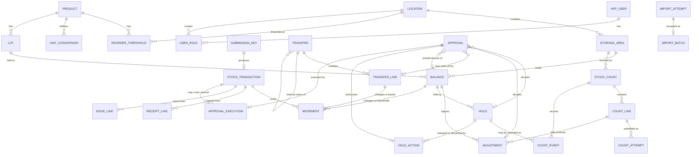

# Step 4: Data Model

This model enforces the Step 3 rules in the database where possible, and in one service layer where it cannot. Stock history is append-only from Phase 1. Tables marked **P2** exist in the schema now and are populated when P2 is built.

**Conventions**
- Primary keys are integers (`INTEGER PRIMARY KEY` on SQLite, `BIGINT GENERATED ... AS IDENTITY` on PostgreSQL).
- Quantities are integers in base units. Dates are `DATE` (no time). Timestamps are UTC `TIMESTAMP`.
- Enumerations are `TEXT` with a `CHECK` constraint, so both databases behave the same.
- `UUID` submission keys are stored as text.

## 4.1 Entity Relationship Diagram

## 4.2 Reference Data

**`location`** (P1)
- `location_id` PK
- `code` TEXT NOT NULL UNIQUE
- `name` TEXT NOT NULL
- `kind` TEXT NOT NULL CHECK (`kind` IN ('clinic','supply_hub'))
- `active` BOOLEAN NOT NULL DEFAULT TRUE

**`storage_area`** (P1). The row is the locking anchor for all stock operations on the area (see 4.9).
- `storage_area_id` PK
- `location_id` FK → `location`, NOT NULL
- `name` TEXT NOT NULL
- UNIQUE (`location_id`, `name`)

**`product`** (P1)
- `product_id` PK
- `sku` TEXT NOT NULL UNIQUE
- `name` TEXT NOT NULL
- `base_unit` TEXT NOT NULL
- `expiry_required` BOOLEAN NOT NULL

**`unit_conversion`** (P1)
- `conversion_id` PK
- `product_id` FK → `product`, NOT NULL
- `purchase_unit` TEXT NOT NULL
- `factor` INTEGER NOT NULL CHECK (`factor` > 0)
- UNIQUE (`product_id`, `purchase_unit`)

**`reorder_threshold`** (P1)
- PK (`product_id`, `location_id`)
- `product_id` FK → `product`; `location_id` FK → `location`
- `min_qty` INTEGER NOT NULL CHECK (`min_qty` >= 0)

**`app_user`** (P1 holds the fictional actor; P2 enforces roles)
- `user_id` PK; `display_name` TEXT NOT NULL; `active` BOOLEAN NOT NULL DEFAULT TRUE

**`user_role`** (P2 enforcement; the table exists in P1)
- `user_role_id` PK; `user_id` FK → `app_user` NOT NULL; `location_id` FK → `location` NOT NULL
- `role` TEXT NOT NULL CHECK (role IN ('supply_clerk','clinic_nurse','clinic_manager','administrator'))
- UNIQUE (`user_id`, `location_id`, `role`)

## 4.3 Lots and Balances

**`lot`** (P1)
- `lot_id` PK
- `product_id` FK → `product`, NOT NULL
- `lot_number` TEXT NOT NULL
- `expiration_date` DATE NULL
- UNIQUE (`product_id`, `lot_number`)
- Constraints: `expiration_date` is NOT NULL when the product has `expiry_required` (checked by the service and a trigger on insert and update).
- Immutability: a trigger rejects any update that changes `expiration_date` after creation.

**`balance`** (P1). One row per lot per storage area. Created on first receipt or opening balance.
- `balance_id` PK
- `lot_id` FK → `lot`, NOT NULL; `storage_area_id` FK → `storage_area`, NOT NULL
- `on_hand` INTEGER NOT NULL CHECK (`on_hand` >= 0)
- `held` INTEGER NOT NULL CHECK (`held` >= 0)
- CHECK (`held` <= `on_hand`)
- UNIQUE (`lot_id`, `storage_area_id`)

Rules:
- `held` is always 0 until P2 holds exist. The constraint exists from P1.
- Available quantity is computed, never stored: 0 when the lot is expired on the evaluation date, otherwise `on_hand − held`.
- Every write to `balance` happens in the same transaction as its movements, so the CHECK constraints guard committed state only.

## 4.4 Transactions, Submission Keys, and Movements

**`submission_key`** (P1)
- `submission_key_id` PK
- `actor_id` FK → `app_user`, NOT NULL
- `operation` TEXT NOT NULL CHECK (operation IN ('receipt','issue','count_start','count_add_line','count_submit','count_recount','count_acknowledge','count_complete','count_cancel','hold','release','discard','adjustment','dispatch','transfer_receive','transfer_return','loss_write_off','import','approval_decision'))
- `idempotency_key` TEXT NOT NULL (UUID)
- `request_hash` TEXT NOT NULL (SHA-256 of canonical request body)
- `response_json` TEXT NULL (saved response; written in the same transaction before commit, and returned only to the same actor)
- `created_at` TIMESTAMP NOT NULL
- UNIQUE (`actor_id`, `operation`, `idempotency_key`)

Isolation rules:
- Keys are scoped by actor and operation. The same UUID from another actor is an unrelated request. It never reveals another actor's saved response.
- A retry returns `response_json` only after the actor's current permission to the affected location is checked again. A retry by an actor who lost access receives 403.
- The key row is inserted in the same transaction as the work it records. If the work fails, the key is not stored either.
- Concurrent duplicates: the second insert waits on the unique index (PostgreSQL) or on the write lock (SQLite). It then reads the committed row. It returns the saved response if `request_hash` matches, and 409 if it differs.

**`stock_transaction`** (P1). Only committed transactions are stored. Rejected requests have no row here.
- `transaction_id` PK
- `submission_key_id` FK → `submission_key` UNIQUE NOT NULL
- `operation_type` TEXT NOT NULL CHECK (operation_type IN ('receipt','issue','count_completion','adjustment','opening','dispatch','transfer_receipt','return_dispatch','return_receipt','hold','release','discard','loss_write_off'))
- `location_id` FK → `location` NOT NULL
- `actor_id` FK → `app_user` NOT NULL
- `packing_slip_ref` TEXT NULL (never used for identity)
- `count_id` FK → `stock_count` NULL
- `transfer_id` FK → `transfer` NULL
- `created_at` TIMESTAMP NOT NULL

**`movement`** (P1). Append-only. Each row changes exactly one balance or one transfer line.
- `movement_id` PK
- `transaction_id` FK → `stock_transaction` NOT NULL
- `balance_id` FK → `balance` NULL
- `transfer_line_id` FK → `transfer_line` NULL
- `delta_on_hand` INTEGER NOT NULL DEFAULT 0
- `delta_held` INTEGER NOT NULL DEFAULT 0
- `delta_in_transit` INTEGER NOT NULL DEFAULT 0
- `reason` TEXT NOT NULL
- `occurred_at` TIMESTAMP NOT NULL
- CHECK (exactly one of `balance_id` and `transfer_line_id` is NOT NULL)
- CHECK (`balance_id` IS NULL OR `delta_in_transit` = 0)
- CHECK (`transfer_line_id` IS NULL OR (`delta_on_hand` = 0 AND `delta_held` = 0))
- CHECK (NOT (`delta_on_hand` = 0 AND `delta_held` = 0 AND `delta_in_transit` = 0))

Enforcement:
- The application role has no UPDATE or DELETE on `movement`. On SQLite, triggers abort both. On PostgreSQL, role grants and a trigger enforce the same.
- Movements are inserted only inside the transaction that also inserts their `stock_transaction` and updates the affected balance or transfer line.

Traceability rules:
- A balance can be rebuilt from committed movements: `on_hand` = SUM(`delta_on_hand`), `held` = SUM(`delta_held`) for its `balance_id`. A test checks this after every scenario.
- A transfer line's in-transit quantity is rebuilt the same way: SUM(`delta_in_transit`) for its `transfer_line_id`.
- Rejected requests write no `stock_transaction`, `movement`, `balance`, or `transfer_line` changes. Rejections are logged to `rejected_request` (P1, see 4.9), which is not stock history.

**`receipt_line`** (P1)
- `receipt_line_id` PK; `transaction_id` FK → `stock_transaction` NOT NULL
- `lot_id` FK → `lot`; `storage_area_id` FK → `storage_area`
- `purchase_unit` TEXT NULL; `purchase_qty` INTEGER NULL CHECK (`purchase_qty` > 0)
- `factor` INTEGER NOT NULL CHECK (`factor` > 0) (copied from `unit_conversion`, or 1 for base-unit entry)
- `base_qty` INTEGER NOT NULL CHECK (`base_qty` > 0)
- CHECK (`purchase_qty` IS NULL OR `purchase_qty` * `factor` = `base_qty`)

**`issue_line`** (P1)
- `issue_line_id` PK; `transaction_id` FK NOT NULL
- `lot_id` FK → `lot`; `storage_area_id` FK → `storage_area`
- `base_qty` INTEGER NOT NULL CHECK (`base_qty` > 0)

Issue rule: an issue draws only from available quantity (`on_hand − held`, or 0 when the lot is expired). Requests above available quantity are rejected. Held units are never issued, but unheld units of a partly held balance can be.

## 4.5 Counts (P1)

**`stock_count`** (P1)
- `count_id` PK
- `storage_area_id` FK → `storage_area` NOT NULL
- `status` TEXT NOT NULL CHECK (status IN ('open','completed','cancelled'))
- `opened_by` FK → `app_user` NOT NULL; `opened_at` TIMESTAMP NOT NULL
- `closed_at` TIMESTAMP NULL
- `reminder_flagged_at` TIMESTAMP NULL (set when open longer than 24 hours; never changes status)
- Partial unique index: one row WHERE status = 'open' per `storage_area_id`

**`count_line`** (P1). One line per lot and storage area in the count, including surplus.
- `count_line_id` PK
- `count_id` FK → `stock_count` NOT NULL
- `product_id` FK → `product` NOT NULL; `lot_number` TEXT NOT NULL
- `lot_id` FK → `lot` NULL (NULL for a new lot until completion creates it)
- `pending_expiration_date` DATE NULL (required for a new lot whose product requires expiry)
- `storage_area_id` FK → `storage_area` NOT NULL
- `balance_id` FK → `balance` NULL (NULL until completion creates the balance)
- CHECK (`lot_id` IS NULL OR `balance_id` IS NULL OR `balance_id` belongs to `lot_id`)
- `expected_qty` INTEGER NOT NULL CHECK (`expected_qty` >= 0) (snapshot at count start; 0 for surplus)
- `state` TEXT NOT NULL CHECK (state IN ('pending','within','out','resolved_recount','adjusted'))
- `resolution_note` TEXT NULL
- UNIQUE (`count_id`, `storage_area_id`, `product_id`, `lot_number`)

Surplus stock: a count can add a line (`count_add_line`) for a product and lot number with no balance in an area. The line is created under the storage-area lock with `expected_qty` 0.
- Existing lot: the line stores `lot_id`.
- New lot: the line stores the product, lot number, and pending expiration date; `lot_id` stays NULL. Nothing is created in `lot` or `balance` yet.
- Completion, per surplus line, in the completion transaction: resolve the lot (create it if it still does not exist, or reuse it if it now exists with the same expiration date; a different expiration rejects completion), recheck expiration rules, create the balance, and post the increase only if the final counted quantity is above zero. An existing-lot surplus line with a final count of zero creates no balance and no movement.
- Cancellation: keeps the count history (lines and attempts) and creates no lots, balances, or movements.

**`count_attempt`** (P1). Every physical submission is kept, so recounts are traceable.
- `count_attempt_id` PK
- `count_line_id` FK → `count_line` NOT NULL
- `attempt_no` INTEGER NOT NULL CHECK (`attempt_no` >= 1), UNIQUE (`count_line_id`, `attempt_no`); the highest `attempt_no` is the accepted attempt
- `counted_qty` INTEGER NOT NULL CHECK (`counted_qty` >= 0)
- `variance` INTEGER NOT NULL (= `counted_qty` − `expected_qty`)
- `within_tolerance` BOOLEAN NOT NULL (computed: ABS(`variance`) <= MAX(2, FLOOR(0.02 × `expected_qty`)))
- `submitted_by` FK → `app_user`; `submitted_at` TIMESTAMP NOT NULL
- `submission_key_id` FK → `submission_key` NOT NULL

Line state rules:
- `pending`: no attempt yet.
- `within`: latest attempt is within tolerance. Adjusted automatically at completion.
- `out`: latest attempt is out of tolerance. Blocks completion until a recount is within tolerance (`resolved_recount`) or P2 approval produces an adjustment (`adjusted`).
- A recount clears a line only if its newest attempt is within tolerance. Otherwise the line stays `out`.
- Zero expected and zero counted gives variance 0 and no movement.

**`adjustment`** (P1 for automatic count adjustments; P2 for approved out-of-tolerance and manual adjustments)
- `adjustment_id` PK
- `lot_id` FK → `lot` NULL; `storage_area_id` FK → `storage_area` NULL. Manual adjustments require both. Count-generated adjustments leave them NULL and derive product, lot number, and area from `count_attempt → count_line`; they are resolved at completion.
- `balance_id` FK → `balance` NULL (NULL until resolved at completion)
- CHECK (source = 'manual' AND lot_id IS NOT NULL AND storage_area_id IS NOT NULL AND count_attempt_id IS NULL OR source <> 'manual' AND count_attempt_id IS NOT NULL)
- Unique index on `count_attempt_id` WHERE NOT NULL: one adjustment per attempt. A zero-variance attempt creates none.
- `count_attempt_id` FK → `count_attempt` NULL (the attempt that produced this adjustment)
- `direction` TEXT NOT NULL CHECK (direction IN ('increase','decrease'))
- `qty` INTEGER NOT NULL CHECK (`qty` > 0)
- `source` TEXT NOT NULL CHECK (source IN ('count_within','count_out','manual'))
- `reason` TEXT NOT NULL
- `requested_by` FK → `app_user` NOT NULL
- `decided_by` FK → `app_user` NULL; `decided_at` TIMESTAMP NULL
- `status` TEXT NOT NULL CHECK (status IN ('pending','approved','rejected','applied','cancelled','superseded'))
- `transaction_id` FK → `stock_transaction` NULL (set only when applied)
- `superseded_at` TIMESTAMP NULL; `superseded_by_attempt_id` FK → `count_attempt` NULL (supersession is recorded here, never as a decision)
- CHECK (source <> 'count_within' OR decided_by IS NULL)
- CHECK (source = 'count_within' OR status IN ('pending','cancelled','superseded') OR decided_by IS NOT NULL)
- CHECK (decided_by IS NULL OR decided_by <> requested_by)
- CHECK (status <> 'applied' OR transaction_id IS NOT NULL)

Lifecycle by source:
- `count_within`: created at submission. No approval. Applied when the count completes. Cancelled if the count is cancelled.
- `count_out`: created at submission as `pending`. A Clinic Manager sets it to `approved` or `rejected` (P2). Approval records the decision only and posts no movement. All approved count adjustments are applied together at completion. Cancellation sets them to `cancelled`. A rejected adjustment leaves its line `out` until a recount within tolerance or a documented resolution clears it.
- `manual` (P2): requires approval. Applied in its own transaction when approved.
- Supersession: a new attempt on a line marks that line's earlier `pending` or `approved` adjustments `superseded`, and their approvals `superseded`. Completion applies only adjustments whose `count_attempt_id` is the line's highest `attempt_no`. Superseded records keep any decision metadata they already have, and supersession is never recorded as a manager decision, so undecided requests carry no decider. Example: count 97 (proposed decrease of 3), then recount 98 (within tolerance, decrease of 2): the 97 adjustment and its approval are superseded, and only the 98 adjustment is applied.

**`count_event`** (P2). Safety holds placed during an open count.
- `count_event_id` PK
- `count_id` FK → `stock_count` NOT NULL
- `hold_id` FK → `hold` NOT NULL
- `acknowledged_by` FK → `app_user` NULL
- `acknowledged_at` TIMESTAMP NULL
- CHECK (`acknowledged_by` IS NULL = `acknowledged_at` IS NULL)

Count completion requires every count_event to be acknowledged.

## 4.6 Holds and Approvals (P2)

**`hold`** (P2)
- `hold_id` PK
- `balance_id` FK → `balance` NOT NULL
- `original_qty` INTEGER NOT NULL CHECK (`original_qty` > 0)
- `remaining_qty` INTEGER NOT NULL CHECK (`remaining_qty` >= 0)
- `reason` TEXT NOT NULL CHECK (reason IN ('damaged_packaging','storage_concern','expiration_concern','recall','labeling_error','count_safety','other'))
- `status` TEXT NOT NULL CHECK (status IN ('active','closed'))
- `placed_by` FK → `app_user` NOT NULL; `placed_at` TIMESTAMP NOT NULL
- `count_id` FK → `stock_count` NULL (set when placed during an open count)
- `submission_key_id` FK → `submission_key` NOT NULL
- `closed_at` TIMESTAMP NULL
- CHECK (status = 'active' OR remaining_qty = 0)
- CHECK (status = 'closed' OR remaining_qty > 0)

Hold rules:
- A new hold covers only unheld quantity: `original_qty` <= `on_hand` − `held`.
- `balance.held` equals the sum of `remaining_qty` over active holds on that balance, updated in the same transaction.
- Expired stock may be held. Safety holds during a count are allowed and recorded in `count_event`.

**`hold_action`** (P2). Each partial or full release or discard of a hold.
- `hold_action_id` PK
- `hold_id` FK → `hold` NOT NULL
- `approval_id` FK → `approval` NOT NULL, UNIQUE (one execution per approval)
- `transaction_id` FK → `stock_transaction` NOT NULL
- `action` TEXT NOT NULL CHECK (action IN ('release','discard'))
- `qty` INTEGER NOT NULL CHECK (`qty` > 0)

Invariant: for each hold, `original_qty` = `remaining_qty` + SUM(`hold_action.qty`). A release reduces `held` by `qty`. A discard reduces `held` and `on_hand` by `qty`. Released expired stock remains unavailable.

Each `hold_action` must satisfy: `qty` equals the approval's `qty`; the hold named by the approval is the hold acted on; `action` matches the approval type (release or discard). The hold remainder, balance, and movements update in the same transaction as the action row. The action's `transaction_id` must equal the `approval_execution.transaction_id` for its approval.

**`approval`** (P2)
- `approval_id` PK
- `request_type` TEXT NOT NULL CHECK (request_type IN ('release','discard','adjustment','loss_write_off'))
- `hold_id` FK → `hold` NULL (release, or a discard of held stock)
- `balance_id` FK → `balance` NULL (discard of unheld stock)
- `adjustment_id` FK → `adjustment` NULL
- `transfer_line_id` FK → `transfer_line` NULL
- `qty` INTEGER NOT NULL CHECK (`qty` > 0)
- `reason` TEXT NOT NULL
- `requested_by` FK → `app_user` NOT NULL; `requested_at` TIMESTAMP NOT NULL
- `decided_by` FK → `app_user` NULL; `decided_at` TIMESTAMP NULL
- `decision` TEXT NOT NULL CHECK (decision IN ('pending','approved','rejected','superseded'))
- `decision_reason` TEXT NULL
- `superseded_at` TIMESTAMP NULL (set when a newer count attempt supersedes the request; no decider is recorded)
- CHECK (decided_by IS NULL OR decided_by <> requested_by)
- CHECK (decision IN ('pending','superseded') OR decided_by IS NOT NULL)
- CHECK (
    (request_type = 'release'        AND hold_id IS NOT NULL AND balance_id IS NULL AND adjustment_id IS NULL AND transfer_line_id IS NULL)
 OR (request_type = 'discard'        AND ((hold_id IS NOT NULL AND balance_id IS NULL) OR (hold_id IS NULL AND balance_id IS NOT NULL)) AND adjustment_id IS NULL AND transfer_line_id IS NULL)
 OR (request_type = 'adjustment'     AND adjustment_id IS NOT NULL AND hold_id IS NULL AND balance_id IS NULL AND transfer_line_id IS NULL)
 OR (request_type = 'loss_write_off' AND transfer_line_id IS NOT NULL AND hold_id IS NULL AND balance_id IS NULL AND adjustment_id IS NULL))

Exactly one target matches each request type: release → hold; discard → hold or balance; adjustment → adjustment; loss write-off → transfer line.

**Applying an approval** (one execution per approval). Under the relevant storage-area and balance or transfer-line locks, the apply step verifies: `decision` = 'approved'; the target matches `request_type`; the action quantity equals `approval.qty`; the approval has no existing `approval_execution` row (UNIQUE `approval_id`) and no `hold_action` (UNIQUE `approval_id`); the adjustment is still `approved` and not superseded (for adjustment requests); and the decider is still authorized for the location. Any failure rejects the apply and changes nothing.

Approval decisions create no movements. The approved action creates its own transaction when applied. A rejected request leaves its target unchanged.

**`approval_execution`** (P2). Links each approval to the transaction that executed it. One transaction may execute several approvals, for example a whole count completion.
- `approval_execution_id` PK
- `approval_id` FK → `approval` UNIQUE NOT NULL (one execution per approval)
- `transaction_id` FK → `stock_transaction` NOT NULL (many approvals may share one transaction)
- `adjustment_id` FK → `adjustment` NULL (the specific applied adjustment, required for adjustment approvals)

**`audit_event`** (P2). Configuration and user changes. Stock history stays in `movement`.
- `audit_event_id` PK; `actor_id` FK NOT NULL; `entity` TEXT; `entity_id` INTEGER; `action` TEXT; `before_json` TEXT NULL; `after_json` TEXT NULL; `occurred_at` TIMESTAMP

## 4.7 Transfers and In-Transit Stock (P2)

Stock in transit belongs to a transfer line. It does not belong to any storage area.

**`transfer`** (P2)
- `transfer_id` PK
- `kind` TEXT NOT NULL CHECK (kind IN ('standard','internal_return'))
- `source_area_id` FK → `storage_area` NOT NULL
- `destination_area_id` FK → `storage_area` NOT NULL
- `return_of_line_id` FK → `transfer_line` NULL (required when kind = 'internal_return')
- `status` TEXT NOT NULL CHECK (status IN ('draft','open','closed','cancelled'))
- `created_by` FK → `app_user`; `created_at` TIMESTAMP NOT NULL
- `dispatched_at` TIMESTAMP NULL; `closed_at` TIMESTAMP NULL
- CHECK (`source_area_id` <> `destination_area_id`)

Status transitions: `draft` → `open` (dispatch), `draft` → `cancelled` (no movements), `open` → `closed` (only when every line's in-transit is 0). A cancelled or open transfer cannot be cancelled. After dispatch, an internal return is used instead.

**`transfer_line`** (P2)
- `transfer_line_id` PK
- `transfer_id` FK → `transfer` NOT NULL
- `lot_id` FK → `lot` NOT NULL
- `dispatched` INTEGER NOT NULL CHECK (`dispatched` > 0)
- `received` INTEGER NOT NULL DEFAULT 0 CHECK (`received` >= 0)
- `written_off` INTEGER NOT NULL DEFAULT 0 CHECK (`written_off` >= 0)
- `returned_out` INTEGER NOT NULL DEFAULT 0 CHECK (`returned_out` >= 0)
- CHECK (`received` + `written_off` + `returned_out` <= `dispatched`)
- `in_transit` is derived: `dispatched` − `received` − `written_off` − `returned_out`, and must be >= 0. It is stored only as a cached value checked against SUM(`movement.delta_in_transit`).

Meaning of the quantities:
- `received`: arrived at the destination and posted to destination on-hand.
- `written_off`: approved loss.
- `returned_out`: moved into an internal-return transfer. It stays in transit there (see `return_transfer` below) until the sender confirms receipt. It is never deducted from the sender's on-hand a second time.

**Internal return flow** (P2)
- A return is a `transfer` with `kind = 'internal_return'` and `return_of_line_id` pointing at the original line.
- Return dispatch: `returned_out` on the original line increases; the return line's `dispatched` increases by the same quantity. Movements: one on the original transfer line (`delta_in_transit` −q) and one on the return line (`delta_in_transit` +q). No `balance` changes.
- Return receipt at the sender: the return line's `received` increases; the sender's balance `on_hand` increases; one movement on the return line (−q) and one on the sender balance (+q).
- Quantity in the return line is in transit until the sender confirms receipt. Its in-transit is `dispatched − received − written_off` on that return line.

## 4.8 Imports and Audit (P1)

**`import_attempt`** (P1). Every attempt is recorded.
- `import_attempt_id` PK
- `file_hash` TEXT NOT NULL; `file_name` TEXT NOT NULL
- `actor_id` FK → `app_user` NOT NULL; `attempted_at` TIMESTAMP NOT NULL
- `status` TEXT NOT NULL CHECK (status IN ('accepted','rejected'))
- `error_list` TEXT NULL (JSON array of row, field, and message)
- Partial unique index: one row WHERE status = 'accepted' per `file_hash` (an identical accepted file cannot apply twice)

**`import_batch`** (P1)
- `import_batch_id` PK
- `import_attempt_id` FK → `import_attempt` UNIQUE NOT NULL
- `row_count` INTEGER NOT NULL CHECK (`row_count` >= 0)

Opening balances are `stock_transaction` rows with `operation_type = 'opening'`. They create new `balance` rows only. An existing balance is never overwritten by an import.

## 4.9 Concurrency, Locking, and Transaction Strategy

**Reference direction.** `stock_transaction` references `submission_key` (`submission_key_id`). Nothing references a transaction from a key, so there is no circular reference. Insert order: submission key, then stock transaction, then movements and balance or transfer-line updates, then the key's `response_json`, then commit.

**Order of checks for every mutating request**
1. Begin a transaction.
2. Look up `submission_key` by (`actor_id`, `operation`, `idempotency_key`). If found, re-check the actor's current authorization for the affected location, compare `request_hash`, and return `response_json` (or 409 on a hash mismatch). Stop here, with no locks and no writes. This runs before operational restrictions, so a retry after a count starts still returns its original result.
3. If not found, lock the `storage_area` row of every affected area, in ascending `storage_area_id`.
4. Re-check the submission key after the lock. A request that waited on the lock may have become a retry while it waited. If a matching key exists, return its saved response (or 409 on a hash mismatch).
5. Check each locked area for an open `stock_count`. If one exists, only that count's own operations are allowed: add line, submit, recount, acknowledge, approval decision on its adjustments, complete, cancel. The P2 safety hold is also allowed. Anything else is rejected with a message naming the count.
6. Lock affected `balance` rows (ascending `balance_id`) and `transfer_line` rows (ascending `transfer_line_id`). Transfer receipt and internal return both reduce a line's in-transit quantity under these locks, so they cannot consume the same units concurrently.
7. Run the checks. Insert the `submission_key` and its `response_json`. If quantities change, also insert the `stock_transaction`, its movements, the `approval_execution` rows (if any), and the cached balance or line updates. Operations that change no quantity (count start, approval decisions, zero-variance completion) save only their own operational rows and the response, with no empty `stock_transaction`. Then commit. Any failure rolls all of it back. A rejection is logged separately (see `rejected_request`).

**Count start** uses the same protocol. It locks the `storage_area` row, verifies there is no open count, and inserts `stock_count` with its `count_line` snapshot. The storage-area row is the anchor because there may be no count row to lock.

**Adding surplus lines, submitting, and recounting** lock the storage area and then the affected balance rows. A recount inserts a new `count_attempt`. Earlier attempts are never overwritten.

**Count completion** runs in one transaction under the storage-area lock:
- Each `count_line` must be `within`, `resolved_recount`, or `adjusted`. Any `pending` line rejects completion. Any `out` line needs an approved `count_out` adjustment (P2).
- Every `count_event` must be acknowledged. A hold placed after an acknowledgement creates a new, unacknowledged `count_event`, so completion rejects until someone acknowledges it.
- Apply only the adjustments for each line's highest `attempt_no`: all `count_within` adjustments and approved `count_out` adjustments that are not `superseded` or `cancelled`. Each adjustment moves from `approved`/`pending` to `applied` only under the storage-area lock, after checking its status, so it can post once. Process surplus lines as described in 4.5. Zero-variance lines create no movement.
- Check `0 ≤ held ≤ on_hand` and `on_hand ≥ 0` for every affected balance. Reject completion if any check fails.
- Set `stock_count.status = 'completed'`, then commit, which releases the lock.

**Count cancellation** runs under the same lock. It sets the count to `cancelled`, sets its `count_within` and `count_out` adjustments to `cancelled`, and makes no stock changes.

**SQLite strategy**
- Every write transaction begins with `BEGIN IMMEDIATE`, so writers are serialized. Steps 3 and 6 then re-verify state inside the write lock.
- WAL journal mode, with a busy timeout so readers do not block the writer.

**PostgreSQL strategy**
- `READ COMMITTED`, with `SELECT ... FOR UPDATE` on `storage_area`, then `balance` and `transfer_line`, in the ascending orders above.
- The unique index on `submission_key` (`actor_id`, `operation`, `idempotency_key`) serializes concurrent duplicates.
- The partial unique index on open counts is a backstop, not the primary lock.

**Rejection logging**
- `rejected_request`: `rejected_request_id` PK, `actor_id` FK, `operation`, `reason_code`, `message`, `attempted_at`. Written in a separate transaction after the failed attempt rolls back. It stores no request bodies, credentials, or tokens, and it never affects stock history.

## 4.10 Invariants to Test

1. `0 ≤ held ≤ on_hand` and `on_hand ≥ 0` for every balance after every committed transaction.
2. `balance.on_hand` = SUM(`movement.delta_on_hand`) and `balance.held` = SUM(`movement.delta_held`) for every balance.
3. For every transfer line: `in_transit` = `dispatched` − `received` − `written_off` − `returned_out` ≥ 0, and equals SUM(`movement.delta_in_transit`).
4. At most one open count per storage area.
5. No stock-changing operation commits while an open count locks its area, except that count's own operations and the P2 safety hold.
6. Each (actor, operation, idempotency key) maps to at most one `stock_transaction`. A request with the same key and a different `request_hash` never commits.
7. An expired lot's available quantity is 0 at every storage area.
8. `lot.expiration_date` never changes after creation.
9. Rejected requests produce no `movement`, `balance`, or `transfer_line` changes.
10. Every `stock_transaction` has at least one `movement`.
11. Zero-variance count completion, transfer cancellation, and approval decisions produce no `movement` rows.
12. A count line is `within` only when its newest attempt satisfies `ABS(variance) <= MAX(2, (2 × expected) / 100)`, using integer arithmetic.
13. A count completes only when every line is resolved, every `count_out` line has an approved adjustment, and every `count_event` is acknowledged.
14. A transfer's in-transit units are consumed at most once: receipts, written-off, and returned-out never exceed dispatched, even under concurrent receipt and return.
15. A decision is never made by the requester (adjustments and approvals).
16. For every hold: `original_qty` = `remaining_qty` + SUM(`hold_action.qty`).
17. Count adjustments of source `count_out` are posted only at completion. Approval decisions post nothing.
18. A hold added after an acknowledgement requires a new acknowledgement before completion.
19. Each approval produces at most one stock transaction or hold action, even across submission keys.
20. Each approval targets exactly one record that matches its request type.
21. A count adjustment posts only if its `count_attempt_id` is the line's highest `attempt_no`. Superseded adjustments never post.
22. A new-lot surplus line creates no `lot` or `balance` until completion, and cancellation creates none.
23. Each count attempt has at most one adjustment, and a zero-variance attempt has none.
24. Each `hold_action.transaction_id` equals the `approval_execution.transaction_id` of its approval.
25. Supersession adds no decider and preserves existing decision metadata.
26. One count completion may execute many approvals, each executing at most once.

## P1 Implementation Notes (SQLite, recorded at the P1 foundation milestone)

- **User identifiers** are text (`app_user.user_id`, for example `counter_rfc`), not integers. Foreign keys to users use the same text value. The PostgreSQL port should keep text IDs or record the change explicitly.
- **P2 tables are deferred.** `hold`, `hold_action`, `approval`, `approval_execution`, `transfer`, `transfer_line`, `count_event`, and `audit_event` are not created in the P1 schema. They are added in the P2 build with their own tests.
- **`issue_line`** uses `lot_id` and `storage_area_id`, as specified in this document.
- **Receiving is built** (`receive()` in `inventory_p1.py`). It stores `receipt_line` rows with the purchase unit, purchase quantity, the conversion factor used, and the base quantity; a schema check requires `purchase_qty * factor = base_qty`. All lines post in one transaction, and the idempotency key is saved with the response. The opening loader stays separate.
- **Quantity storage.** Integer quantities are enforced by `typeof(...) = 'integer'` CHECKs as well as by the service layer. SQLite's INTEGER affinity alone accepts REAL values. Booleans cannot be distinguished from integers at the database level, so the service and loader reject them.
- **Dates.** Expiration dates must be canonical `YYYY-MM-DD` calendar dates, enforced by CHECK constraints and by the service and loader.
- **Count cancellation** (`count_cancel`) releases the area without stock changes. It keeps count lines and attempts and sets pending adjustments to `cancelled`.
